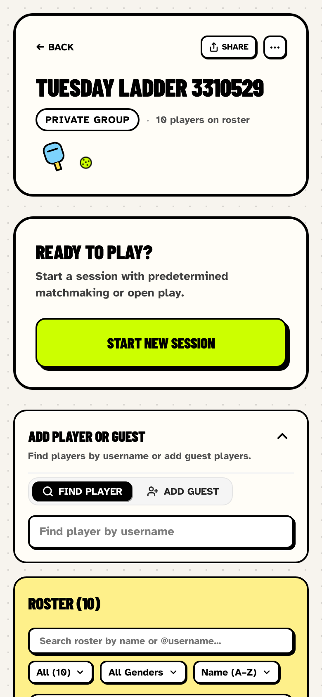
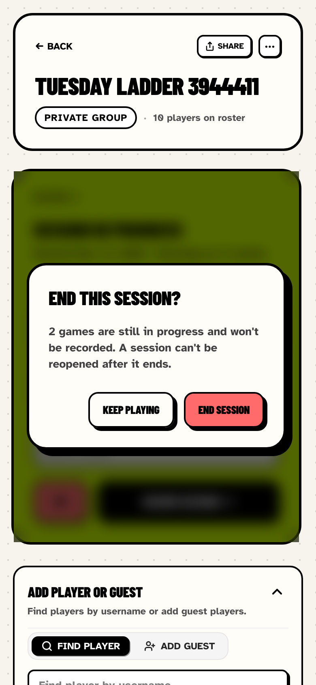
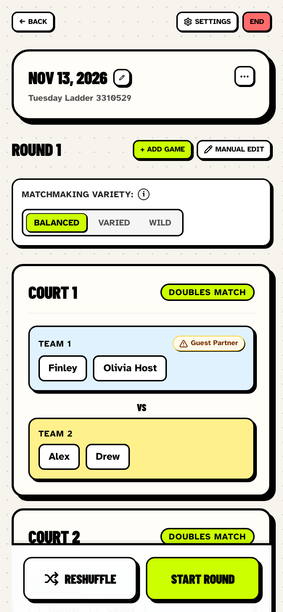
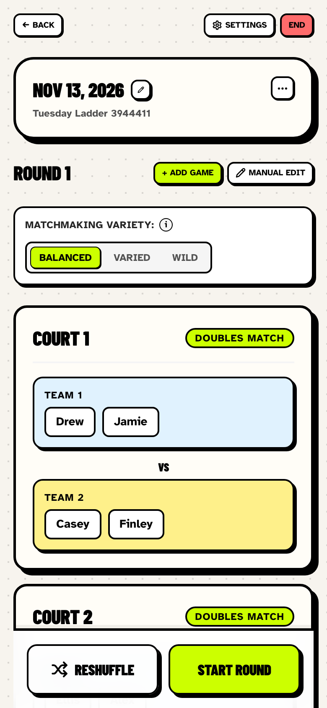
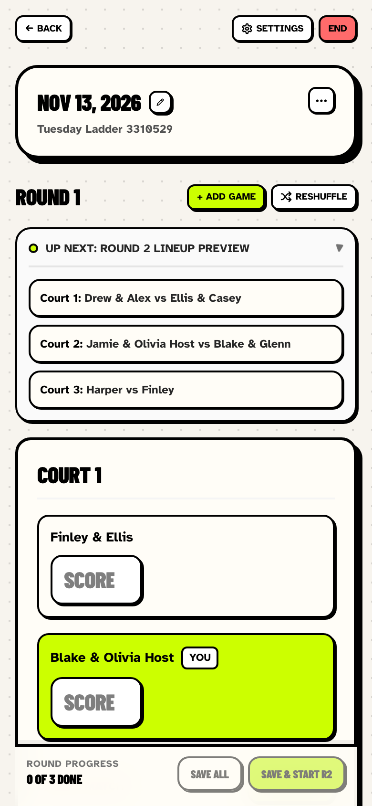
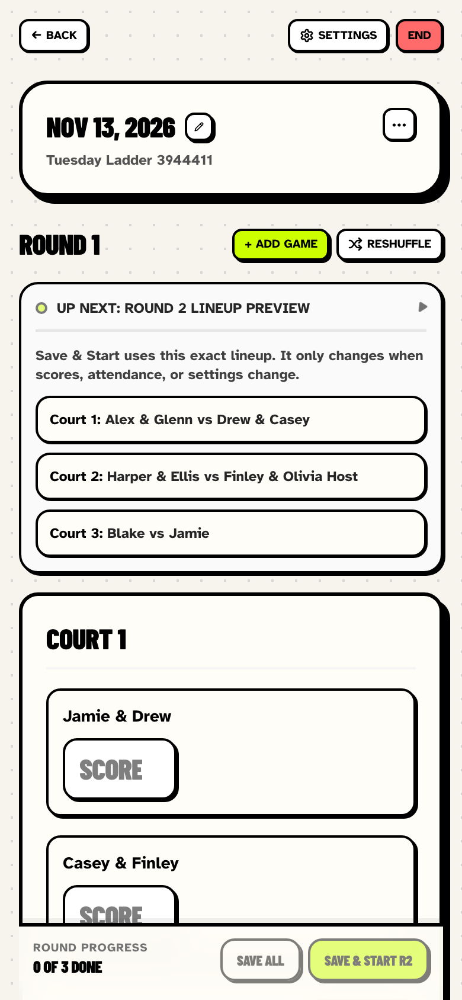
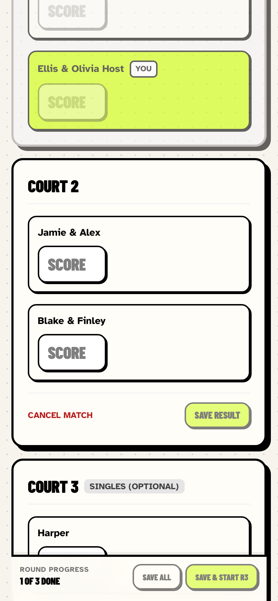
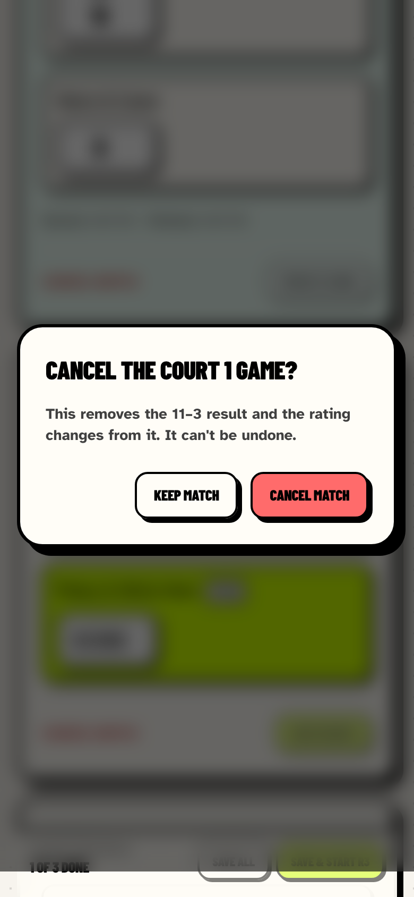
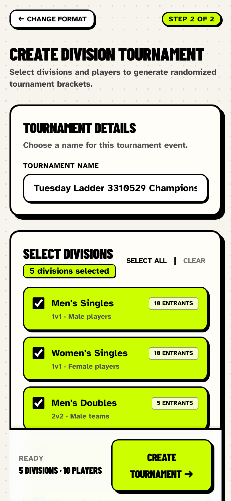
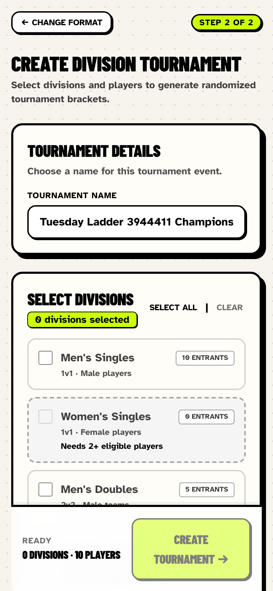

# Organizer-side fixes: safeguards, stable lineups, honest tournaments

These fixes address the P0 and four P1 organizer issues from the [UX critique](2026-11-13-ux-critique.md). The organizer P2s are still open; see "Not covered" at the end.

## How the screenshots were taken

The before and after screenshots come from the same Playwright script. It runs against the local dev server on port 3100 (test database) at 390 × 844, with 2× pixel density. The script runs one organizer's evening:

1. Create a group with 10 players; the default court setup gave 2 doubles courts and a singles court.
2. Start a session and reload the proposal page twice.
3. Start Round 1, reload with the Up Next preview open, save every court, then Save & Start Round 2.
4. Save an 11–3 final on Round 2 and tap **Cancel match** on it.
5. Go to the dashboard and tap **End**.
6. Open the tournament form with an all-male roster.

Screenshots are in `output/playwright/organizer-fixes-2026-11-13/{before,after}/`, and the measurements are in each folder's `report.json`.

| Check | Before | After |
|---|---|---|
| Proposed lineup identical across two reloads | no | yes |
| Up Next preview identical after a reload | no | yes |
| Round 2 matches the preview at Save & Start | yes | yes |
| One tap on Cancel match wipes a saved final | yes | no, asks first |
| Dashboard End asks first | no | yes |
| Session still live after tapping End on the dashboard | no, ended | yes (backed out) |
| Women's Singles entrants, all-male roster | 10 | 0, can't be selected |
| Divisions pre-selected | 5 | 0 |

## P0: The dashboard End asks before ending a session

The **End** button on the group dashboard used to call `endSessionAction` straight away. It sits next to **Resume Session**, sessions can't be reopened, and any unscored court was lost.

**Fix:** `EndSessionNowButton` now opens an **End this session?** confirmation. The dialog:
- says how many games are still in progress and won't be recorded (open play: that players won't be able to log more games),
- warns that a session can't be reopened,
- offers **Keep playing** to back out.

The group page passes in the number of games in progress.

| Before: one tap ended the session | After: the same tap asks first |
|---|---|
|  |  |

## P1: The proposed lineup no longer reshuffles on reload

**Before:** every server render proposed the next round with a random seed. Reloading, the phone locking, a second tab, or a co-organizer's phone each showed a different lineup.

**Fix:**
- The seed is now fixed per session and round (`defaultLineupSeed` in `src/lib/rounds/lineup-seed.ts`). The server proposal and the client's own proposal calls both use it, so the lineup only changes when attendance, pairs, settings, or results change.
- An explicit **Reshuffle** or variety change is saved on the device and reapplied after a reload, until that round starts or the session changes.

| Before: first load | Before: after reload |
|---|---|
|  |  |

| After: first load | After: after reload |
|---|---|
|  |  |

## P1: Up Next shows the lineup Save & Start will use

**Before:** the preview was recomputed with a new random seed on every render. It showed sitters and courts that then didn't happen, so players were told the wrong thing. Save & Start did start whatever the preview showed at that moment, but the preview kept changing.

**Fix:**
- The preview uses the same fixed seed for the next round, so it only moves when the inputs move.
- It now says so: "Save & Start uses this exact lineup. It only changes when scores, attendance, or settings change."

| Before: preview, then the same preview after a reload | After: preview after a reload |
|---|---|
|   |  |

## P1: Cancel match asks first, and says what it removes

**Before:** **Cancel match** removed a game in one tap, including a saved final with its rating effect. Nothing can restore a cancelled match.

**Fix:** tapping it opens **Cancel the Court N game?**:
- For a finished game it says: "This removes the 11–3 result and the rating changes from it. It can't be undone."
- For an unfinished game it says that nobody on the court gets a result this round.
- **Keep match** backs out.

| Before: one tap, the final is gone | After: confirmation names the score |
|---|---|
|  |  |

## P1: Tournament divisions only contain eligible players

**Before:** all five divisions were pre-selected. When a division had fewer than 2 eligible players, it fell back to the whole roster. A men-only group got Women's Singles, Women's Doubles and Mixed Doubles brackets made of men.

**Fix:**
- `createParticipantsForDivision` is now strict. Each gendered division only takes players of that gender, Mixed Doubles only pairs one man with one woman, and players with no gender set are left out.
- The form starts with nothing selected. A division with fewer than 2 entrants is greyed out and marked "Needs 2+ eligible players", and **Select All** skips it.
- The server rejects such a division with a clear message.

| Before | After |
|---|---|
|  |  |

## Tests

**Unit/component tests:**
- `tests/rounds/lineup-seed.test.ts`: the fixed seed, identical proposals, and parsing the saved Reshuffle choice.
- `tests/components/end-session-now-button.test.tsx`: the confirmation text.
- `tests/components/results.test.tsx`: the Cancel match warning.
- `tests/tournament/bracket.test.ts`: no borrowing across genders, man-and-woman-only mixed teams, and players with no gender left out.
- `tests/actions/tournaments.test.ts`: the server rejects an ineligible division.

**E2E tests:**
- New `organizer-safeguards.spec.ts`:
  - the lineup is identical across reloads, and a Reshuffle survives a reload
  - tournament divisions start unselected, and ineligible ones are disabled
- Updated `corrections.spec.ts`:
  - **Keep match** backs out of a cancel
  - the dashboard End asks first, both normal and open play
- Updated `session-revalidation.spec.ts`: it now measures the confirm tap.
- Run: these specs plus `stay-together`, `acceptance` and `tournaments`, in both the Mobile Chrome and Desktop Chrome projects. The full suite was not run.

## Not covered

- **Reshuffle across devices:** a Reshuffle is remembered only on the device that made it. A co-organizer's phone shows the default lineup for that round. Sharing a reshuffle needs the proposal saved on the server.
- **Undo and reopen:** there is still no way to undo a cancelled match or reopen an ended session. Both actions now ask first instead.
- **Organizer P2s:** still open:
  - the late-arrival flow buried in Settings
  - the roughly 2-second freeze after each round advance, while End reads "ENDING…"
  - no played/sat tally during a session
  - no session summary after End
  - tournament bye and TBD labels
