# P2 fixes: player and organizer

These fixes address the P2 issues from the [UX critique](2026-11-13-ux-critique.md), plus the tap-target, keypad and motion findings from its detector pass. Colour contrast is still deliberately deferred.

## How the screenshots were taken

The before and after screenshots come from the same Playwright script. It runs against the local dev server on port 3100 (test database) at 390 × 844 with 2× density, and plays out an evening with four people:
1. The organizer runs an 8-player, 2-court session.
2. Jordan, a member, watches as a player.
3. A signed-in non-member opens the session link.
4. A signed-out visitor opens the same link.

Screenshots are in `output/playwright/p2-fixes-2026-11-13/{before,after}/`, and the measurements are in each folder's `report.json`.

| Check | Before | After |
|---|---|---|
| Player has a "leaving after this round" control | no | yes |
| Leave Group dialog mentions the live session | no | yes |
| Signed-in non-member opening a session link lands on | `/players` (silently) | the group's join page, then continues to the session |
| Signed-out visitor sees which group the link is for | no | yes, plus a join link |
| Disabled Save & Start says why | no | "Court 2 needs a score. Enter it, or cancel that game, …" |
| Played / sat-out tally during a session | no | yes (collapsed) |
| Attendance row stays in its section after toggling | no, jumps to "Not present" | yes |
| Session summary link on the dashboard after End | no | yes |
| "Your Session" shows the rating change | no | "Rating 3.5 → 3.6 (+0.1)" |
| Profile chart "All" range from the starting rating | from the first session | yes |

The script's `attendanceRowMoved` flag reads true in both runs, because a pixel offset was too crude a measure. In the after run, the existing "Quick presets" panel appears above the list once attendance changes, and that pushes every row down. The screenshot shows Alex still in **Present**, marked Left, and the E2E test checks the row's section rather than its position.

## Player side

### Heading home early, without leaving the group
Players had no way to say "I'm off after this game". The only exit was Leave Group, which removes them from the roster.

**Fix:**
- A new `setMyAttendanceAction` lets a player mark themselves as leaving after the current round, or undo it. It works for account members and for guests on the device they joined from. The server works out who is asking; the client never sends a player id.
- The control sits below the courts, so the "You're on Court N" card stays on top.
- The Leave Group dialog now warns when a session is running, names the court if the player is on one, and points to this control instead.

| Before: live round | After: live round (the leave control is below the courts) |
|---|---|
| 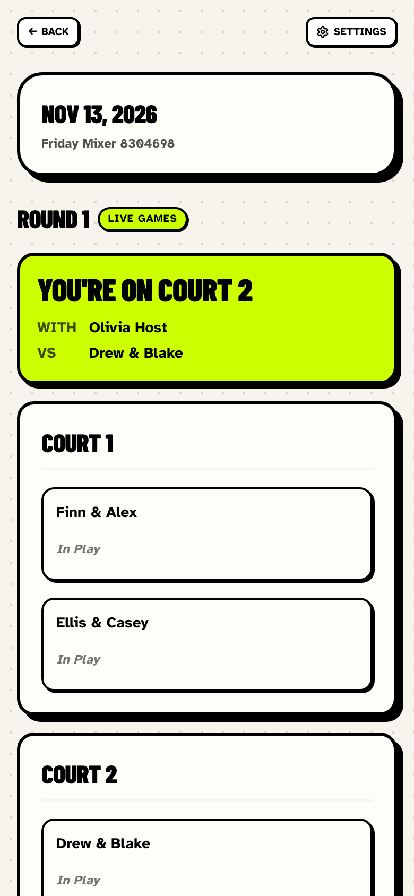 | 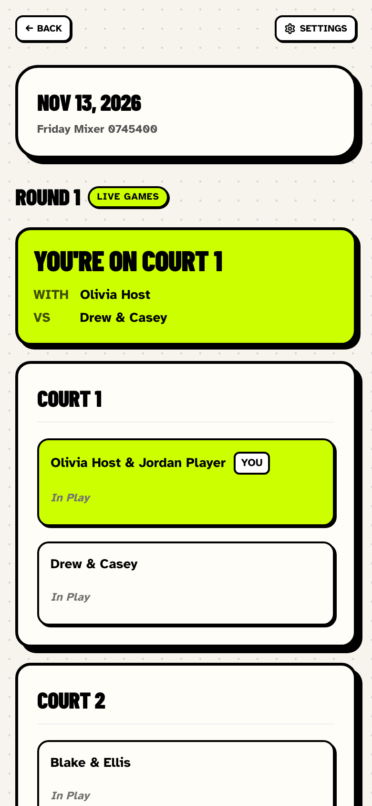 |

| Before: Leave Group mid-session | After |
|---|---|
| 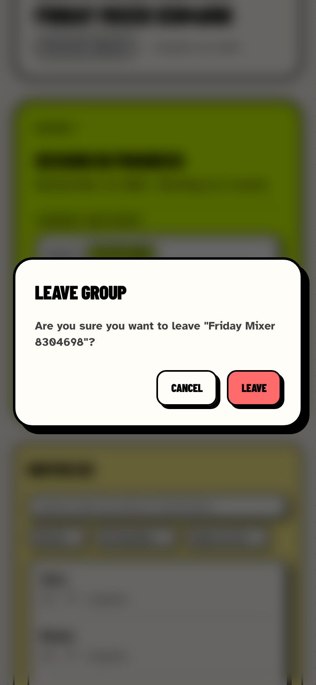 | 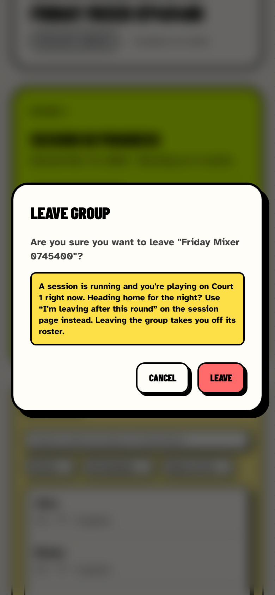 |

**Making it safe for organizers:** a player leaving from their phone can make an organizer's open page out of date.
- Start Round now always checks the lineup against who is present. Previously it only checked when Stay Together pairs were set; Save & Start already checked.
- When the lineup is stale, the error names the player, for example "The lineup is out of date: Jordan left."
- The organizer's page then refreshes itself and holds the start buttons until the updated lineup arrives. A quick second tap can't resend the stale lineup.

### Rating change, chart and chemistry
- **Your Session:** the panel now shows "Rating before → after (change)". It covers the player's first rated game to their last one this session. With no rated doubles games, it says the rating didn't change.
- **Profile chart:** the "All" range starts from the player's starting rating. A first session now reads "3.5 → 3.6" instead of "3.6 → 3.6".
- **Chemistry copy:** the empty state explains that chemistry only tracks partners with player accounts. Before, it said "play matches with other people to unlock" even after games with guest partners.
- **Ratings stay at three decimals:** that's how DUPR itself displays ratings, so it's left as is.

| Before | After |
|---|---|
| 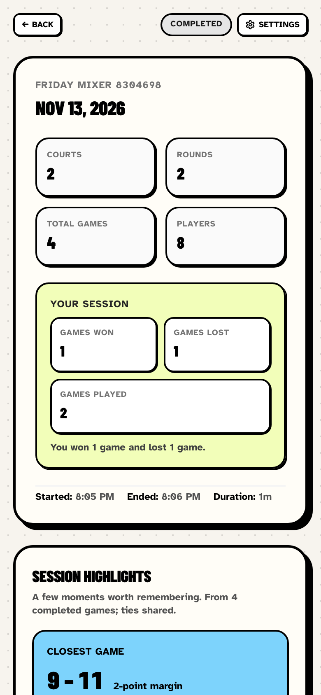 | 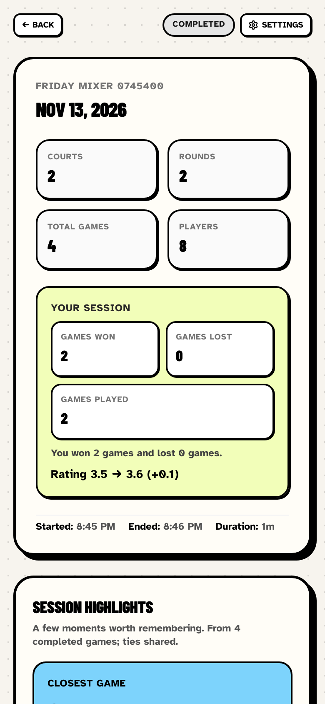 |

### Shared links keep their group
- **Signed-in non-members** opening a session link used to be sent silently to `/players`. They now go to `/g/[id]/join?next=<session>`, and after joining they continue straight to the session.
- **The join page** only honours `next` paths inside the same group.
- **Signed-out visitors** still go to sign in, since most are members with accounts. The sign-in page now says "Sign in to open <Group>" and offers **Not in this group yet? Join as a guest**.

| Before: signed-in non-member | After |
|---|---|
| 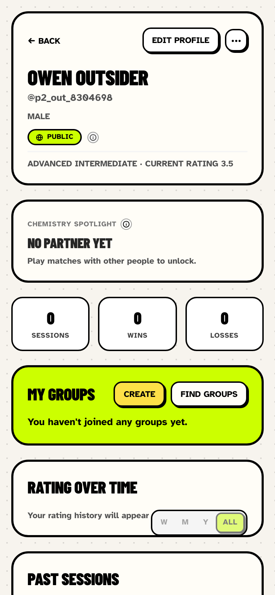 | 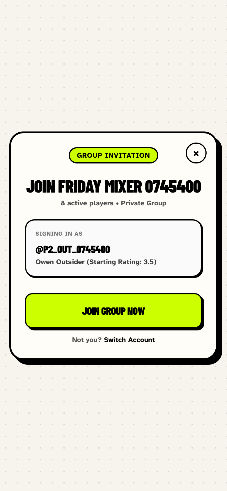 |

| Before: signed-out visitor | After |
|---|---|
| 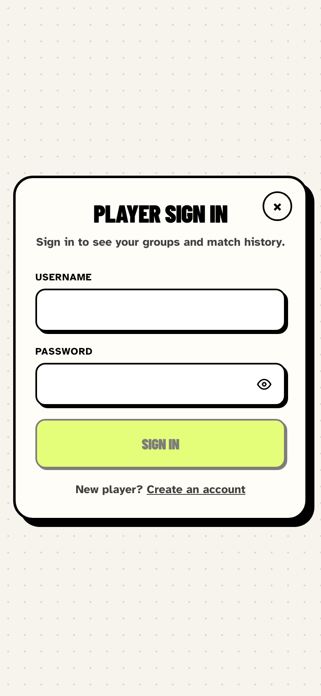 | 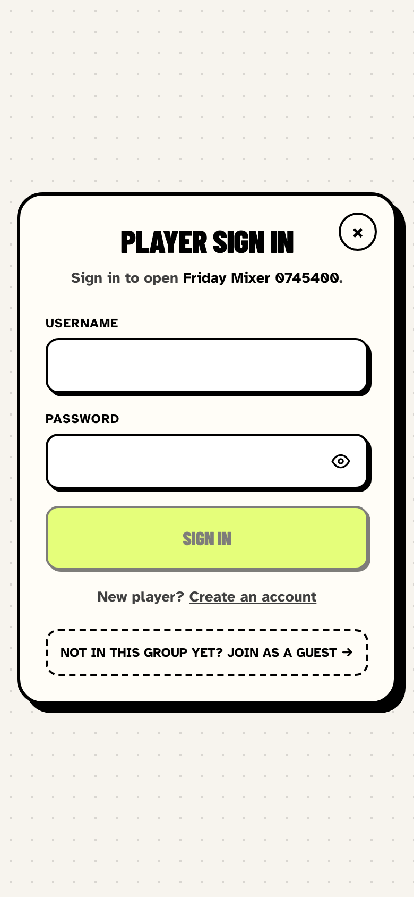 |

## Organizer side

### Attendance list stays still
- **Stable rows:** while Session Settings is open, rows stay in the section they started in, so a row no longer jumps out from under the organizer's thumb. The section counts are live, and the list regroups the next time Settings opens.
- **"Not here" label:** players who never arrived now show **Not here** instead of **Left**.

| Before: Alex jumped to "Not present" | After: Alex stays put, marked Left |
|---|---|
| 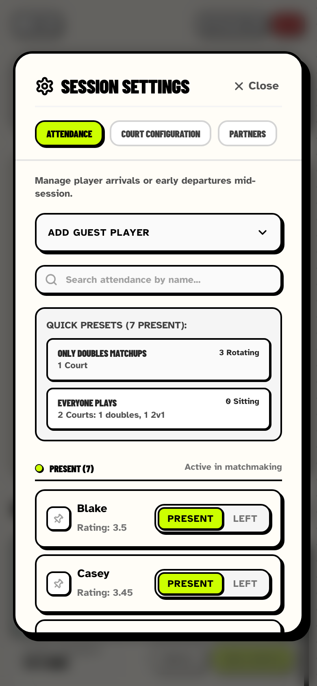 | 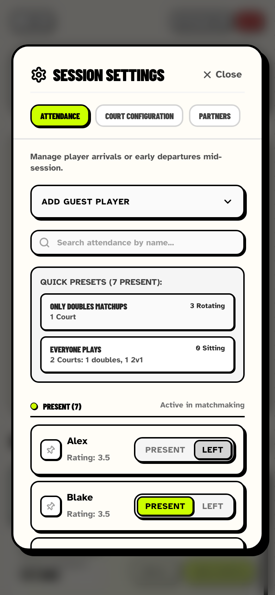 |

### Round advance and score entry
- **End label:** the header End button says "Ending…" only while ending, not during every round advance.
- **Blocked Save & Start:** when Save & Start is disabled, a line above it names the courts that still need a score, or asks to fix score errors.
- **Score drafts:** scores typed but not saved survive a reload of the tab (session storage, only for games still waiting for a result).
- **Keypad:** score inputs open the number keypad on phones (`inputMode="numeric"`).
- **Tap size:** Save Result, Save All and Save & Start are now 44 px tall.

| Before | After |
|---|---|
| 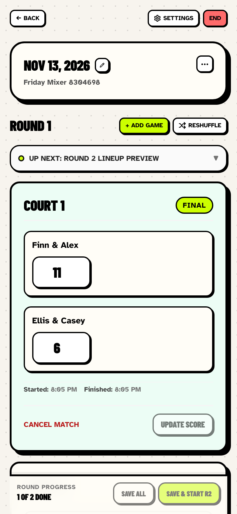 | 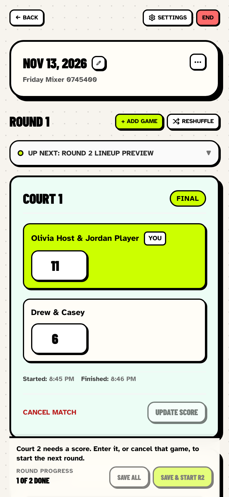 |

### Fairness tally and the end-of-session payoff
- **Tally:** a collapsed **Games played · rounds sat out** panel below the courts lists everyone, most-owed first, with the viewer highlighted. Organizers can answer "why am I sitting again?" on the spot.
- **Summary link:** ending a session still returns to the dashboard, where the sign-off animation plays. That flow is deliberate and covered by tests. For 12 hours afterwards, the dashboard now shows **See the session summary**.

| Round 2 with the tally open | Dashboard after End: before / after |
|---|---|
| 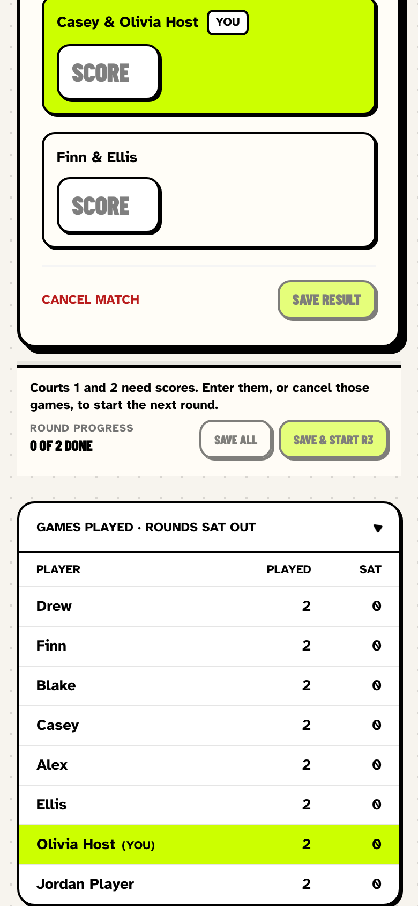 | 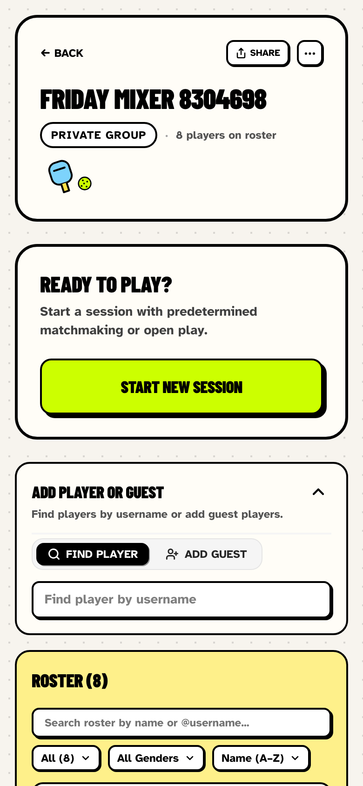 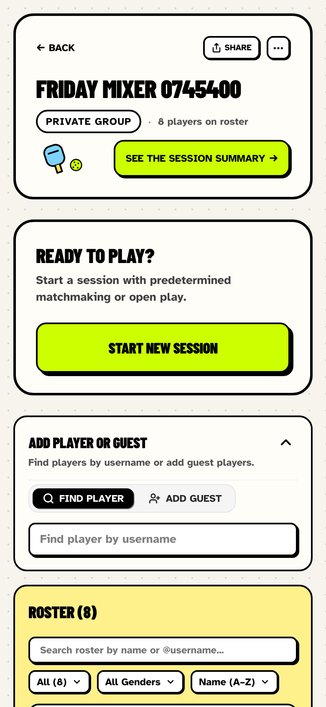 |

### Smaller fixes
- **Tournament cards:** cards whose players aren't decided yet say **Waiting** instead of **In Play**. Byes still say **Skipped**, which an existing test shows was a deliberate choice.
- **Bouncing button:** the "Move to Sitting" button only bounces when reduced motion is off, and is 44 px tall.
- **Small controls:** the 16 px info icons, the shared Back link, and the session header's Back, Settings and End now have invisible padding that brings their tap area to about 44 px. They look the same.

## Tests

- **Unit/component:** 877 pass.
  - New tests cover leaving early (account, guest, refusals), the play tally, score drafts, the Save & Start reason, and the "Not here" label.
  - Also new: the join page carrying `next`, the chart's starting rating, stale lineups being refused with names, and the non-member redirect.
- **E2E updates:**
  - `player-live-session.spec.ts` has a new test. It covers heading home early and the Leave Group warning, then the organizer's stale lineup being refused and retried without the player. It also covers both shared-link paths.
  - `organizer-safeguards.spec.ts` has a new test: drafts survive a reload, the Save & Start reason, stable attendance rows, the tally, and the summary link.
  - `corrections.spec.ts` asserts the Save & Start reason.
- **Full E2E run:** the whole suite ran locally with 120 passed, 0 failed. The 46 tests in `session-action-resilience.spec.ts` skip themselves without a disposable loopback test database, so they only run in CI. They exercise Start Round, which this change made stricter.

## Not covered

- **Players' "sit me out for one round":** this needs engine support for a break state, so players can only leave for the rest of the night.
- **Quick late-arrival control on the round screen:** organizers still mark arrivals in Settings, which is now stable and searchable.
- **Organizer live updates:** the organizer's page still doesn't poll. Stale lineups are caught at start, as described above.
- **Contrast:** still deferred.
