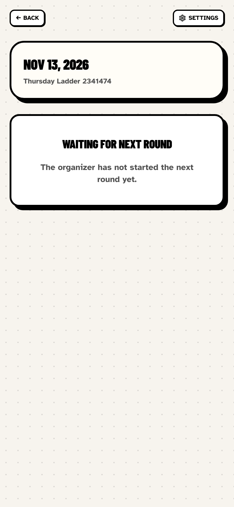
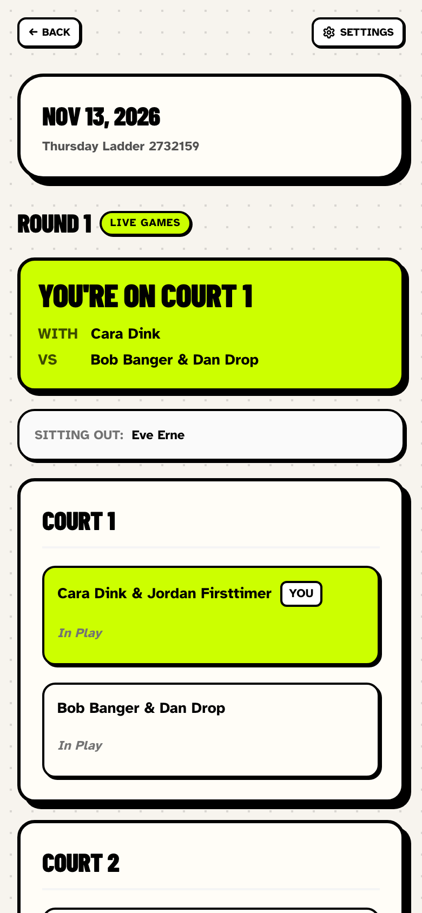
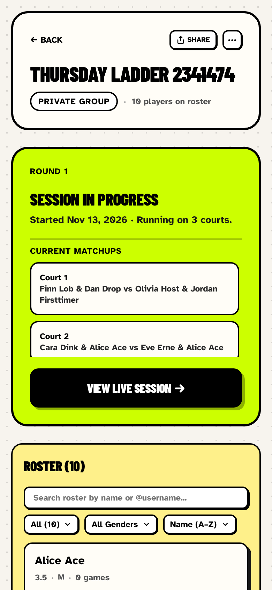
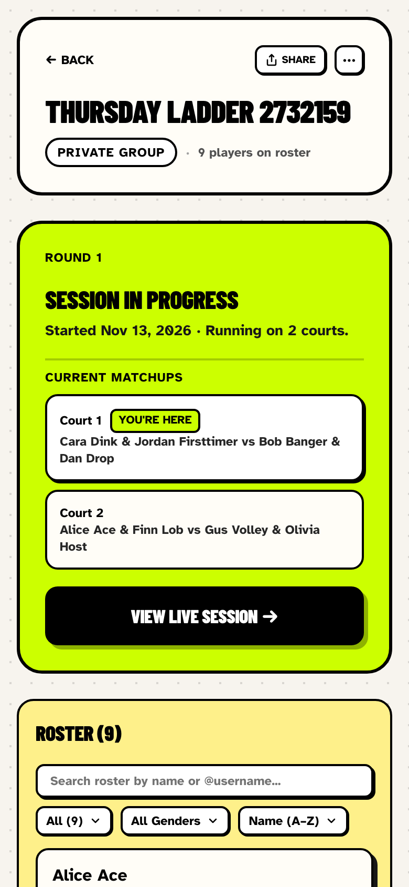
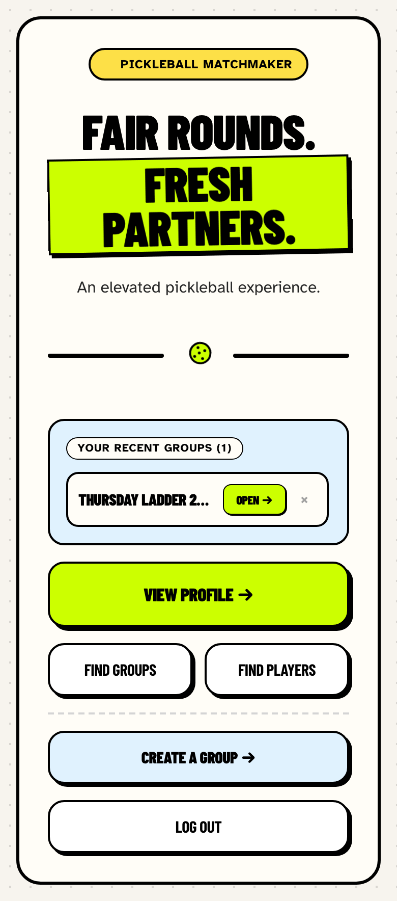
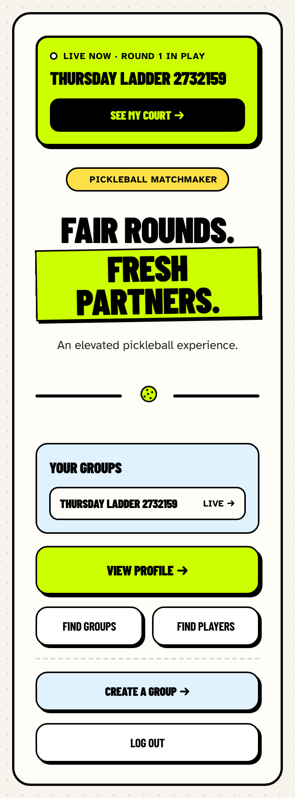
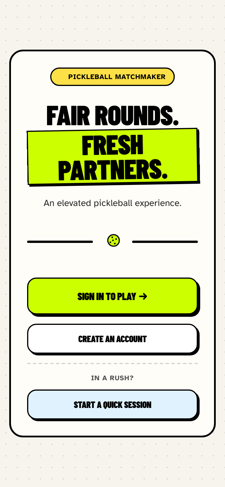
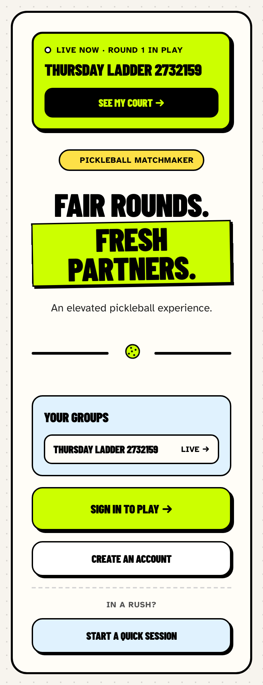

# Player-side fixes: live session, "You" card, guest rejoin, home entry point

These fixes address the P0 and the three P1 player issues from the [UX critique](2026-11-13-ux-critique.md). The organizer-side issues and the player P2s are still open.

## How the screenshots were taken

The before and after screenshots come from the same Playwright script. It runs against the local dev server on port 3100 (test database) at 390 × 844, with 2× pixel density. Three browser contexts play out one evening:

1. **The organizer** creates a group and adds seven guests, including "Alice Ace".
2. **Jordan** signs up through the invite link and joins.
3. **The real Alice** opens the invite link signed out and joins as a guest under her name.
4. **The organizer** starts a session and Round 1, while Jordan has the session page open. The script waits 8 seconds without reloading Jordan's page.

Screenshots are in `output/playwright/player-fixes-2026-11-13/{before,after}/`, and the script's measurements are in each folder's `report.json`.

| Check | Before | After |
|---|---|---|
| Jordan sees Round 1 within 8 s, no reload | no | yes |
| "You" card on the live round | no | yes |
| "Alice Ace" rows on the roster after Alice joins | 2 | 1 |
| Roster size (host + 7 guests + Jordan) | 10 (phantom twin) | 9 |
| Jordan's home links straight to the live session | no | yes |
| Alice's (guest) home shows her group | no | yes |

## P0: The live session updates by itself

Before this fix, the normal-session page refreshed only when a page was restored from the back/forward cache. Players watching a session never saw a new round, a saved score, or the session ending unless they reloaded. Open play already polled for changes; normal sessions didn't.

**Fix:**
- A new server action, `getSessionLiveStampAction`, returns a small fingerprint of the live session: status, round number, version, and each match's status and score. The fingerprint is built by `src/lib/sessions/live-stamp.ts`.
- A new hook, `useLiveSessionSync` (`src/lib/sessions/use-live-session-sync.ts`), checks the fingerprint every 5 s while the tab is visible. It also checks straight away when the tab comes back into view, the window regains focus, or the device reconnects. It reloads the page's data only when the fingerprint has changed.
- Only players poll. Organizers already refresh after each of their own actions, and polling could interfere with scores they are in the middle of typing.

| Before: 8 s after the organizer started Round 1 | After: same moment, no reload |
|---|---|
|  |  |

## P1: Players can see where they're playing

The session page already worked out which player was viewing, but the score cards never received that information. Players had to read every court to find their own name.

**Fix:**
- The live round now opens with a "You" card. When the viewer is playing it shows **"You're on Court N"**, their partner (or "Singles"), their opponents, and the result from their side once the game is final. When they're sitting out it shows **"You're sitting out"**, with a note that they have priority next round.
- The viewer's team is highlighted lime and tagged **You** on its court card.
- On the group dashboard, the viewer's court is listed first under Current Matchups and tagged **You're here**. That list no longer scrolls inside a 136 px box, which used to cut Court 2 off and hide Court 3.

| Before: dashboard during a live round | After: dashboard during a live round |
|---|---|
|  |  |

After reloading, the full live round looks like this: [before](../../output/playwright/player-fixes-2026-11-13/before/player-live-round.png) · [after](../../output/playwright/player-fixes-2026-11-13/after/player-live-round.png).

## P1: Guest self-join no longer duplicates roster guests

Before this fix, `joinAsGuestAction` always created a new player. When the organizer had pre-added Alice and the real Alice then joined from the invite link, the roster had two Alices. Both were picked for the session, so Alice could be scheduled on two courts in the same round.

**Fix:**
- If an active guest with the same name is already on the roster, the joining device takes over that roster spot instead of creating a new player. The name match ignores case and extra spaces.
- An account player's spot is never taken over, even if the names match.
- The join form now explains this: "Already on the roster? Use the name your organizer added and you'll take that spot."
- Unexpected errors now show a plain "try again" message instead of the raw error text.

| Before: roster after Alice joins | After: same flow |
|---|---|
| `aliceRows: 2`, roster 10 | `aliceRows: 1`, roster 9 |

The join form with the new hint: [after](../../output/playwright/player-fixes-2026-11-13/after/guest-join-form.png).

## P1: Home has "Live now" and "Your groups"

Before this fix, the signed-in home page had no shortcut to the player's groups. The only list was "Recent groups", which came from this device's browsing history, so it was empty on a new phone. Guests got the signed-out marketing page with no way back to the group they had joined. Signing in took players to their profile.

**Fix:**
- The home page now loads the player's groups from the server. Signed-in players get the groups on their account; guests get the groups this device joined as a guest.
- Any group with a session in progress gets a lime **Live now** card at the very top, with a **See my court →** button that goes straight to the live session.
- **Your groups** lists every group, with live ones first.
- Signing in without a `?next=` link now goes to the home page instead of the profile.
- The old device-history `RecentGroupsHome` component has been removed.

| Before: signed-in player | After: signed-in player |
|---|---|
|  |  |

| Before: guest | After: guest |
|---|---|
|  |  |

## Tests

- **Unit/component:**
  - `tests/sessions/live-stamp.test.ts`: the fingerprint and the poll action.
  - `tests/components/results.test.tsx`: the "You" card when playing, sitting out, or showing a final result, and the team highlight.
  - `tests/components/share-group.test.tsx`: guest rejoin, and that an account player's spot is never taken over.
  - `tests/components/homepage.test.tsx`: the Live now card, Your groups, and the guest's groups.
- **E2E:**
  - New: `tests/e2e/player-live-session.spec.ts`. It covers the whole evening above: no-reload updates for a round start and a saved score, the "You" card, guest rejoin, and the home live link for both the player and the guest.
  - Updated: `permissions.spec.ts` (Your groups replaces Recent Groups).
  - Both pass in the Mobile Chrome and Desktop Chrome projects. The full suite was not run.

## Not covered

- **Push and vibration:** a new round shows up on screen and is announced through `aria-live`, but there is no vibration or push notification.
- **Group dashboard updates:** the dashboard's live card doesn't update by itself yet. Only the session page polls.
- **Player P2s:** still open. They are leave/sit-out controls, rating change after a session, chemistry with guest partners, and links for non-members.
