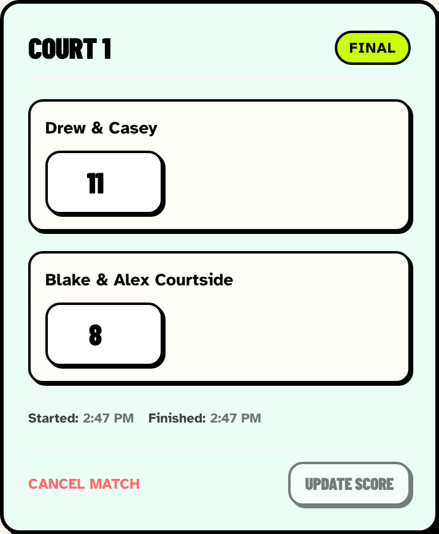
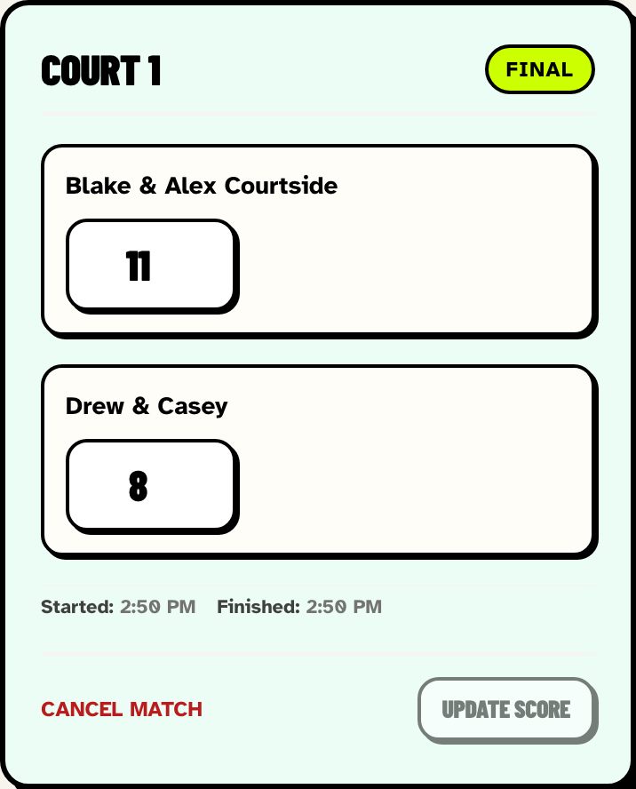
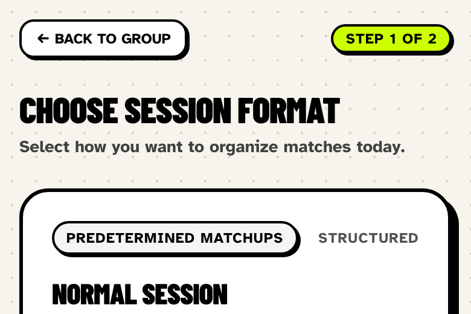
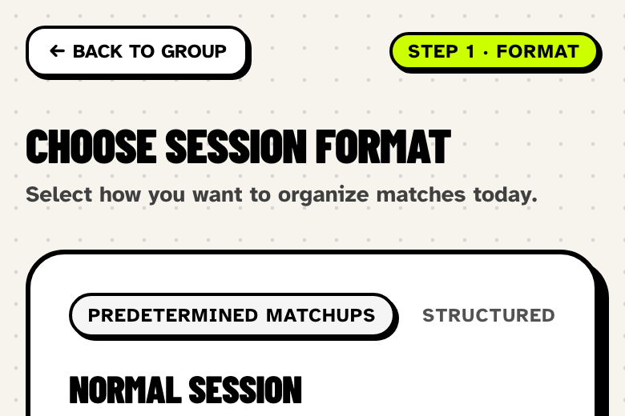
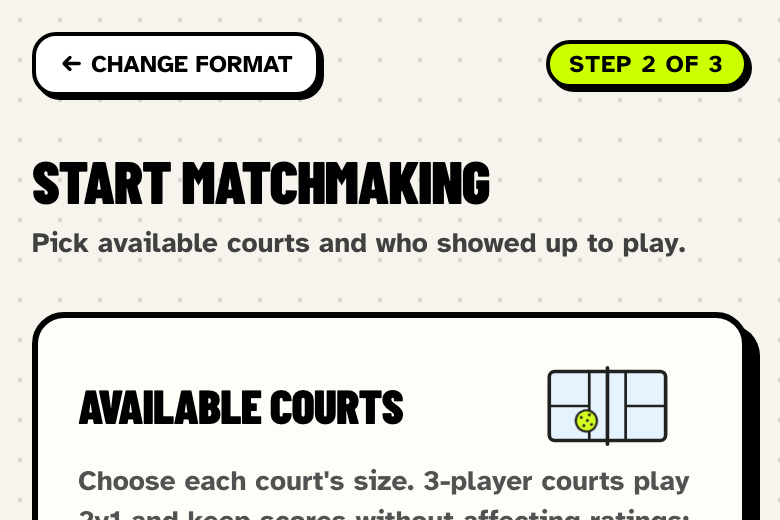
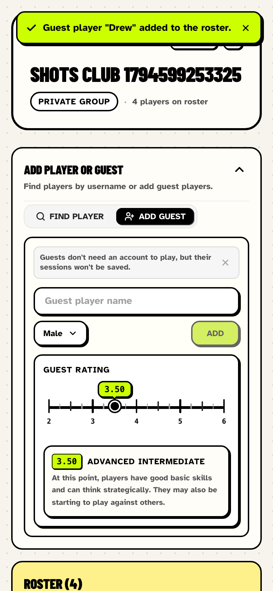
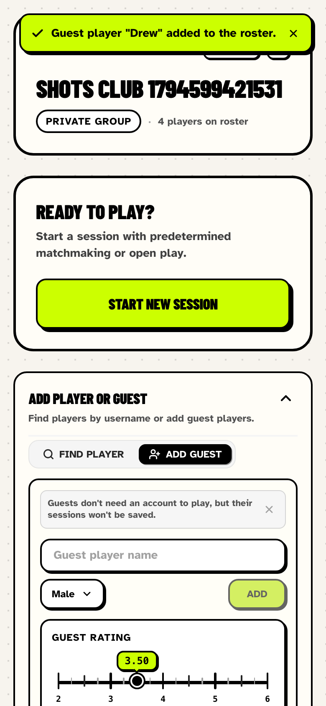
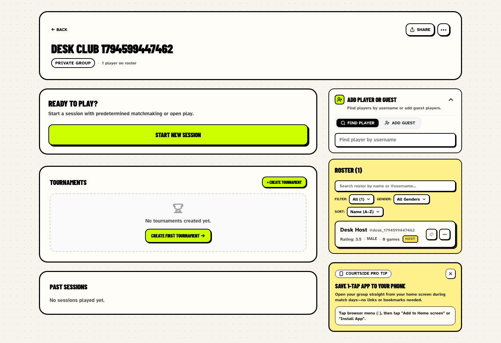
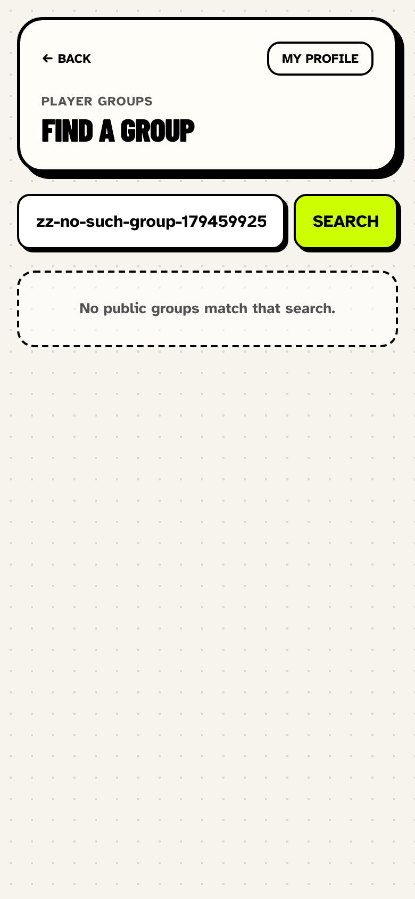
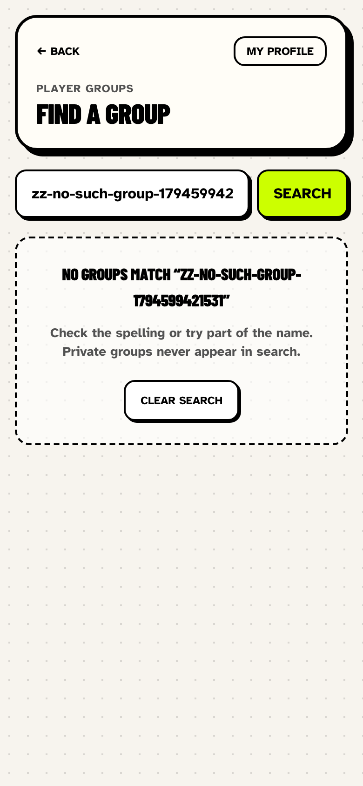

# UI fixes — player and organizer journeys

Follow-up to [the November 13 UI audit](2026-11-13-ui-user-journeys.md). Each of the six findings from that audit was fixed using the Impeccable skill playbook the audit suggested (`harden`, `adapt`, `clarify`, `layout`, `onboard`). The fixes stay within the existing courtside look: same palette, borders, type, and components.

## How the screenshots were taken

The before and after captures come from the same Playwright script, run against the local dev server on port 3100 (test database) at 390 × 844 with 2× pixel density. The script runs the audit's journeys: sign up, search for groups, create a private group, add three guests, start a normal session, and save an 11–8 result. After the result is saved, it measures the Cancel match button and runs axe on `main`. Development overlays are hidden. Screenshots are in `output/playwright/ui-fixes-2026-11-13/{before,after}/`, and the measurements are in each folder's `report.json`.

| Measurement | Before | After |
|---|---|---|
| Axe violations on the scored session (`main`) | 1 (`color-contrast`, 2.63:1) | 0 |
| Cancel match hit area | 90.8 × 16 px | 114.8 × 44 px |
| Start New Session distance from the top of the group page | 1,619 px | 333 px (above the fold) |
| Impeccable detector on changed UI files | — | no findings |

## P1 — Cancel match failed text contrast

`src/components/results/results-entry.tsx`. The text was `#ff6b6b` on the green final-result card, which measures 2.63:1. It is now `#b91c1c`: about 6.2:1 on the final card (`#ecfdf5`) and about 6.4:1 on the open card (`#FFFDF7`). Hovering adds a light red background, and keyboard focus shows a black focus ring.

| Before | After |
|---|---|
|  |  |

## P2 — Cancel match had a 16px-high target

Same component. The button is now `min-h-11` (44 px) with horizontal padding. A negative margin offsets that padding, so the label still lines up with the card content. Compare the button heights in the screenshots above: 16 px before, 44 px after.

## P2 — Session wizard changed its promised length

`src/app/g/[groupId]/sessions/new/new-session-client.tsx`. The first step said “Step 1 of 2”. Picking Normal Session then turned it into “Step 2 of 3”. The total isn't known until a format is chosen, so step 1 now reads **Step 1 · Format**. Later steps show the correct total for the chosen flow: three steps for Normal, two for Open Play.

| Before | After |
|---|---|
|  |  |

Step 2 after picking Normal Session (unchanged, now consistent with step 1):

## P2 — Start New Session sat below the roster on mobile

`src/app/g/[groupId]/page.tsx`. On phones, the roster column came first in the page. That put Start New Session below the expanded guest form, the full roster, and the home-screen tip. The dashboard grid now places the primary session card first on mobile, then the roster and tip, then tournaments and past sessions. This card holds Start New Session, Resume, View Live Session, or the join card, depending on who is viewing. Desktop keeps the same two-column layout. The roster spans both rows on the right, so the session card still sits at the top left.

| Before (first screen on a phone) | After (first screen on a phone) |
|---|---|
|  |  |

Full-page captures: [before](../../output/playwright/ui-fixes-2026-11-13/before/group-dashboard-mobile-full.png) · [after](../../output/playwright/ui-fixes-2026-11-13/after/group-dashboard-mobile-full.png).

Desktop layout after the change (1440 × 900):

## P2 — Empty discovery implied a failed search

`src/components/players/public-group-list.tsx` and `src/app/players/groups/page.tsx`. Every empty result said “No public groups match that search.”, even when nothing had been searched. The page now tells the two cases apart:

- **Search with no results.** “No groups match “<query>””, a reminder that private groups never appear in search, and a **Clear search** button.
- **Empty directory (no search).** “No public groups yet”, a note to ask an organizer for an invite link, and a **Create a group** button. Signed-out visitors see **Create an account** instead.

| Before | After |
|---|---|
|  |  |

The test database already has public groups, so the empty-directory state couldn't be captured in the browser. A component test covers it instead (`tests/components/public-group-list.test.tsx`). The audit's original capture of that state is [discovery.png](../../output/playwright/ui-audit-2026-11-13/discovery.png).

## P2 — Group creation exposed raw database errors

`src/app/actions/auth.ts` (`createAccountGroupAction`). The action used to return `error.message` from any thrown error, so database errors reached the screen word for word. Unexpected failures are now logged on the server with `console.error`. The organizer sees: “We couldn't create your group right now. Your details are still here, so try again in a moment.” The form keeps the name and visibility they entered. If the player isn't signed in, the message is “Sign in to your player account to create a group.” Duplicate names still get the specific “already exists” message.

This failure needs a broken schema to reproduce, so there is no new screenshot. The before state is the audit's [setup-error.png](../../output/playwright/ui-audit-2026-11-13/setup-error.png). The fix is covered by `tests/actions/create-account-group.test.ts`, which makes the insert throw `column "organizer_permissions" does not exist` and checks that this text never reaches the user.

## Tests

- Unit/component: `tests/components/results.test.tsx` (Cancel match colour and size), `tests/components/public-group-list.test.tsx` (both empty states and the signed-out link), `tests/actions/create-account-group.test.ts` (error mapping).
- E2E (the targeted tests below passed in both the Mobile Chrome and Desktop Chrome projects; the full suite was not run):
  - `acceptance.spec.ts`: wizard step labels, plus a new test that Start New Session is above the roster and above the fold at 390 × 844.
  - `corrections.spec.ts`: Cancel match is at least 44 px high and passes an axe contrast check on the final card.
  - `permissions.spec.ts`: discovery no-results copy and the Clear search link.

## Not covered

Dark mode, screen readers, physical touch, and production performance are still unvalidated, as they were in the audit. Three items remain open:

- The detector's `border-l-4` note in `organizers-tab.tsx` is unchanged. The audit judged it intentional.
- The `animate-bounce` reduced-motion check in `current-round.tsx` was not part of these fixes.
- Several E2E axe runs still disable `color-contrast` site-wide. Re-enabling it would need a full contrast pass across every screen.
