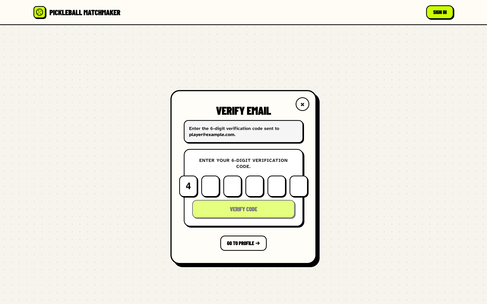
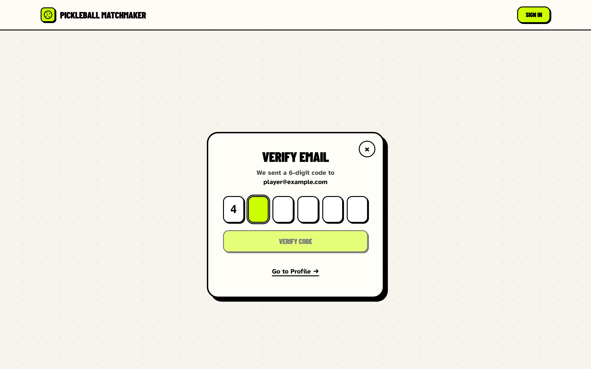
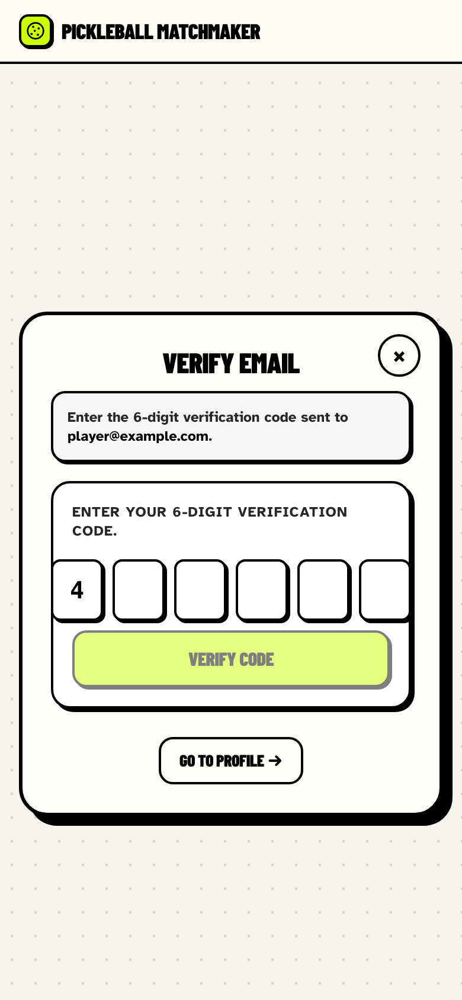
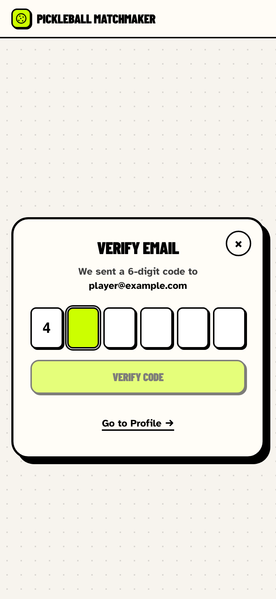
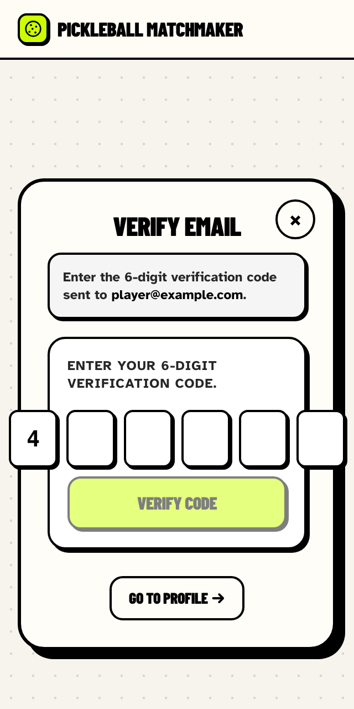
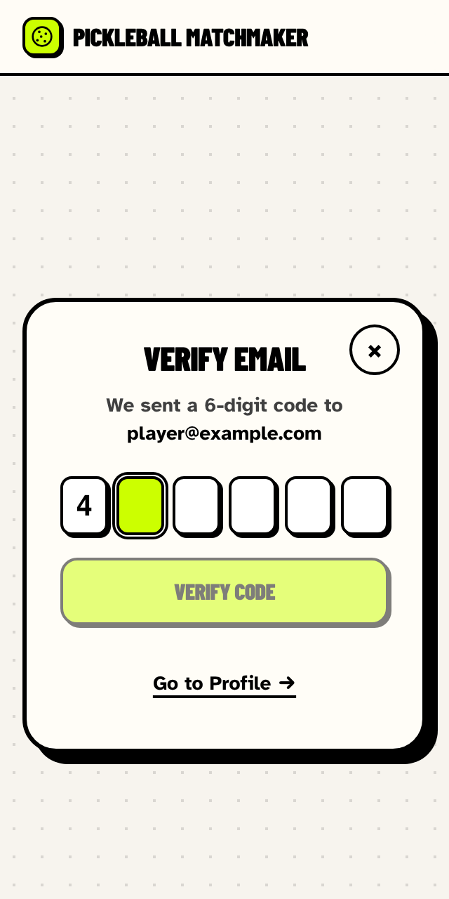

# Verify Email screen clean-up

These fixes come from an Impeccable pass on `/verify-email`. The automated detector found nothing, so every problem below came from looking at the screen itself. The screenshots were taken at 390 × 844, 320 × 640 and 1280 × 800 after typing the first digit. They're in `output/playwright/verify-email-2026-11-17/{before,after}/`, with measurements in each folder's `report.json`.

| Check | Before | After |
|---|---|---|
| Code slots fit inside the card at 1280 px | no, first and last stick out | yes |
| Code slots fit at 320 px | no | yes |
| The instruction is said once | no, the grey box and an uppercase label repeat it | yes |
| Cards nested inside the card | 2 (instruction box, form box) | 0 |
| The next slot is highlighted while typing | no | yes |
| A way to get a new code | none | **Send a new code** (signed-in players) |

## What changed
- **Slots size to the card:** the six slots were 48 px each with fixed gaps, about 338 px in all, inside a box with only about 274 px to spare. They now share the available width (a six-column grid, up to 320 px wide), so they fit on a 320 px phone and on desktop. The same input on `/reset-password` gets the fix too.
- **One instruction:**
  - **Removed:** the grey shadowed box and the uppercase "Enter your 6-digit verification code." label.
  - **Replaced with:** a plain line under the heading, "We sent a 6-digit code to", with the email on its own line. A long address wraps only where it has to, instead of splitting mid-word.
- **No card in a card:** the form box's border and shadow are gone, so the slots and **Verify Code** sit directly in the main card.
- **Active slot highlight:** the lime highlight on the next slot never appeared. The browser focuses the input before React attaches its focus handler, so the "focused" state stayed off. The highlight now comes from CSS `:focus-within`, which works from the first paint.
- **Resend:** signed-in players see "Didn't get it? **Send a new code**". It uses the existing resend action, clears the slots and confirms "New code sent. Check your inbox."
- **Go to Profile:** now a quiet text link instead of a second bordered button, so **Verify Code** is the only button.

| Before: desktop | After: desktop |
|---|---|
|  |  |

| Before: 390 px | After: 390 px |
|---|---|
|  |  |

| Before: 320 px | After: 320 px |
|---|---|
|  |  |

## Not changed
- **Disabled Verify Code button:** still the shared pale-lime style. Colour contrast is still deferred.
- **Reset Password layout:** that page keeps its own boxed form. Only the shared code input changed there.
- **Screenshots are signed out:** they don't show the resend link. Component tests cover it.
