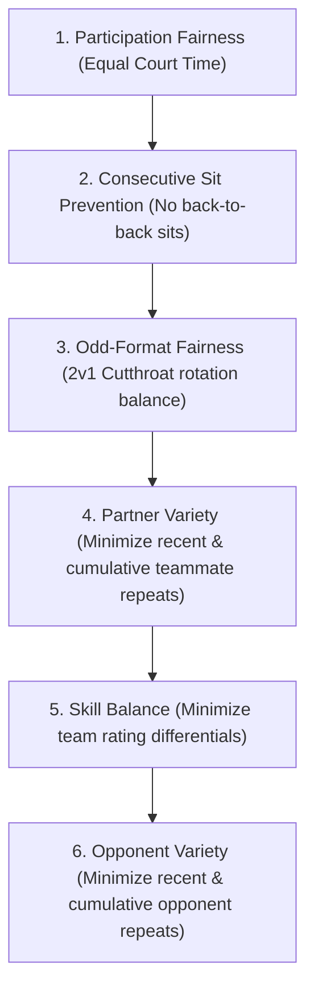

# Pickleball Matchmaking System

The matchmaking system is a pure, framework-independent engine designed to generate fair, balanced, and varied pickleball matches for recurring recreational groups.

It is implemented in TypeScript under [`src/lib/matchmaking/`](../src/lib/matchmaking/) and operates without any database, UI, or clock dependencies.

---

## 1. Core Philosophy & Priority Hierarchy

When generating round matchups, competing goals often pull in opposite directions (e.g. balancing skill ratings vs. preventing players from partnering together again). The engine resolves this using a strict, prioritized penalty hierarchy:



1. **Equal Playing Time**: Everyone present should play approximately the same number of games, even with late arrivals or departures.
2. **Never Sit Twice**: Sitting in consecutive rounds is heavily penalized.
3. **Format Equity**: When odd player counts require cutthroat 2v1 games, 2v1 exposure is evenly distributed.
4. **Partner Variety**: Avoid partnering with the same player again, prioritizing recent rounds.
5. **Skill Balance**: Match opposing teams so total team ratings are as close as possible.
6. **Opponent Variety**: Avoid facing the same opponents repeatedly.

---

## 2. Two-Stage Generation Pipeline

To ensure that pair or skill optimization cannot starve players of court time, the engine separates generation into two discrete stages:

```
[ Active Players + Courts ]
           │
           ▼
┌──────────────────────────────────────────────┐
│ Stage 1: Choose Sitting Players             │
│ • Calculates dynamic participation loads     │
│ • Filters out consecutive sits               │
│ • Deterministic tie-breaking with seed       │
└──────────────────────────────────────────────┘
           │
           │ (Active Roster)
           ▼
┌──────────────────────────────────────────────┐
│ Stage 2: Monte Carlo Candidate Search        │
│ • Generates 5,000 candidate round permutations│
│ • Evaluates all doubles combinations per court│
│ • Computes weighted penalty score            │
│ • Boltzmann Temperature Sampling (T >= 0)   │
└──────────────────────────────────────────────┘
           │
           ▼
[ Optimal Round Lineup & Score Breakdown ]
```

---

## 3. Stage 1: Sitting Selection (Equal Court Time)

Sitting selection is handled in [`src/lib/matchmaking/sitting.ts`](../src/lib/matchmaking/sitting.ts).

### Participation Load Formula

Instead of simply counting raw `gamesPlayed` (which penalizes players who arrived on time when a latecomer joins), the engine computes a **Participation Load** normalized against group attendance:

$$\text{Load} = \frac{\text{gamesPlayed} + \overline{G}_{\text{group}}}{\text{eligibleRounds} + 1}$$

Where:
- $\overline{G}_{\text{group}}$ is the average participation rate of the group:
  $$\overline{G}_{\text{group}} = \frac{\sum \text{gamesPlayed}}{\sum \text{eligibleRounds}}$$
- $\text{eligibleRounds}$ is the number of rounds the player was marked present.

### Selection Ordering

When $N$ players must sit:
1. **Consecutive Sit Guard**: Players who sat in the previous round (`satPreviousRound = true`) are pushed to the bottom of the sit candidate list.
2. **Load Comparison**: Players with higher participation loads sit first.
3. **Random Shuffle**: Exact ties in load are randomized using the seeded PRNG.

---

## 4. Stage 2: Court Assignment & Penalty Scoring

Once the sitting roster is determined, the remaining active players are assigned to courts. The search engine in [`src/lib/matchmaking/generate-round.ts`](../src/lib/matchmaking/generate-round.ts) generates **5,000 randomized permutations** (configured via `iterations`).

For each group of 4 players assigned to a doubles court, the engine evaluates all 3 valid pairings:
- Team 1: $(A, B)$ vs Team 2: $(C, D)$
- Team 1: $(A, C)$ vs Team 2: $(B, D)$
- Team 1: $(A, D)$ vs Team 2: $(B, C)$

### Scoring Objective Function

The total penalty score for a candidate round is:

$$\text{Total Score} = P_{\text{consecutiveSit}} + P_{\text{playingTime}} + P_{\text{2v1}} + P_{\text{partner}} + P_{\text{skill}} + P_{\text{opponent}} + P_{\text{tieBreak}}$$

### Weight Configuration (`src/lib/matchmaking/config.ts`)

| Penalty Factor | Default Weight | Description |
| :--- | :--- | :--- |
| **`consecutiveSit`** | `100` | Penalty per player sitting back-to-back rounds. |
| **`twoVsOneRepeat`** | `100` | Penalty for placing a player in 2v1 cutthroat if they have already played 2v1 recently. |
| **`playingTime`** | `80` | Spread (max load − min load) across all players. |
| **`partnerRepeat`** | `50` | Penalty for re-pairing teammates based on recency and cumulative count. |
| **`skillBalance`** | `20` | Average absolute difference in average team ratings: $\| R_{\text{team 1}} - R_{\text{team 2}} \|$. |
| **`opponentRepeat`** | `10` | Penalty for facing identical opponents based on recency and cumulative count. |
| **`tieBreakMaximum`** | `0.001` | Tiny random deterministic delta to break exact mathematical ties. |

---

## 5. Recency and Pair History Dynamics

Pair history is tracked in [`src/lib/matchmaking/pairs.ts`](../src/lib/matchmaking/pairs.ts) across the current session and decayed long-term sessions:

### Partner & Opponent Recency Decays

Repeated matchups in immediate rounds are penalized far more heavily than matches played hours or days ago:

| Rounds Ago | Partner Penalty | Opponent Penalty |
| :---: | :---: | :---: |
| **1 round ago** | `100` | `25` |
| **2 rounds ago** | `70` | `15` |
| **3 rounds ago** | `50` | `10` |
| **4–5 rounds ago** | `25` | `3` |
| **6–10 rounds ago** | `5` | `0` |

### Long-Term History Factor
In addition to round recency within the current session, cumulative career matchups between players contribute to the penalty with a long-term discount factor:
- **Long-term partner factor**: $0.25 \times \text{totalPartnerCount}$
- **Long-term opponent factor**: $0.10 \times \text{totalOpponentCount}$

---

## 6. Controlled Variety & Temperature Sampling

When organizers want a different matchup proposal (e.g. clicking **"Reshuffle"** in the session UI), the engine supports **Boltzmann Temperature Sampling** ($T \ge 0$):

- **Temperature $T = 0$ (Default)**: Strictly selects the global minimum penalty candidate out of all 5,000 iterations.
- **Temperature $T > 0$ (Variety Sampling)**:
  1. Maintains a candidate pool of the top 30 distinct round combinations.
  2. Assigns a Boltzmann probability weight to each candidate $i$:
     $$W_i = \exp\left( - \frac{\text{Score}_i - \text{BestScore}}{15 \cdot T} \right)$$
  3. Samples probabilistically from the pool.

This ensures that clicking "Reshuffle" produces a noticeably fresh, alternative matchup without degrading into completely unbalanced chaos.

---

## 7. Court Sizing & Odd Formats (2v1 Cutthroat & Singles)

Groups don't always divide neatly into multiples of 4. The engine supports flexible court configuration inputs (`courtPlayerCounts: number[]`):

- **Doubles (4 players)**: Standard $2 \text{ vs } 2$.
- **Singles (2 players)**: Standard $1 \text{ vs } 1$.
- **Cutthroat (3 players)**: $2 \text{ vs } 1$ rotating court.
  - The engine tracks `timesPlayed2v1` per player.
  - Avoids assigning the same player to 2v1 courts repeatedly.
  - Optimizes the 3 possible $2 \text{ vs } 1$ combinations on that court for best rating balance against the solo player.

---

## 8. Seeded Reproducibility

To guarantee deterministic, replayable rounds across server restarts and test runs, the engine uses a 32-bit FNV-1a seeded pseudo-random number generator (`src/lib/matchmaking/random.ts`).

If no explicit seed is passed, a stable hash is generated from:
```typescript
stableInputSeed = hash(courts, courtPlayerCounts, temperature, players[id, gamesPlayed, eligibleRounds, timesPlayed2v1])
```
This guarantees that proposing a round is deterministic, and re-running simulations produces reproducible results.

---

## 9. Key Source Files & Test Suites

- **Algorithm & Pipelines**:
  - [`src/lib/matchmaking/generate-round.ts`](../src/lib/matchmaking/generate-round.ts) — Main round generation loop and candidate pool.
  - [`src/lib/matchmaking/sitting.ts`](../src/lib/matchmaking/sitting.ts) — Participation load calculation and sitting selection.
  - [`src/lib/matchmaking/score-round.ts`](../src/lib/matchmaking/score-round.ts) — Multi-criteria penalty evaluation.
  - [`src/lib/matchmaking/pairs.ts`](../src/lib/matchmaking/pairs.ts) — Recency curves and cumulative pair indexing.
  - [`src/lib/matchmaking/config.ts`](../src/lib/matchmaking/config.ts) — Default weights and penalties.
  - [`src/lib/matchmaking/rating.ts`](../src/lib/matchmaking/rating.ts) — Doubles Elo rating and delta calculation.

- **Tests & Simulations**:
  - `tests/matchmaking/generate-round.test.ts` — Unit tests for generation edge cases, singles, 2v1, and temperature.
  - `tests/matchmaking/sitting.test.ts` — Sitting fairness and participation load tests.
  - `npm run test:simulation` (`tests/simulations/`) — High-iteration fairness and variance verification across simulated seasons.
