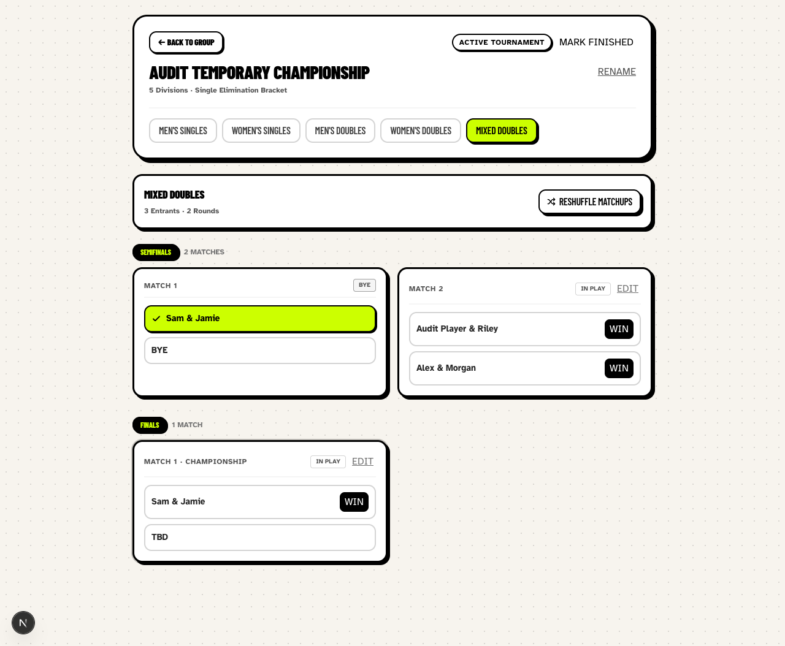
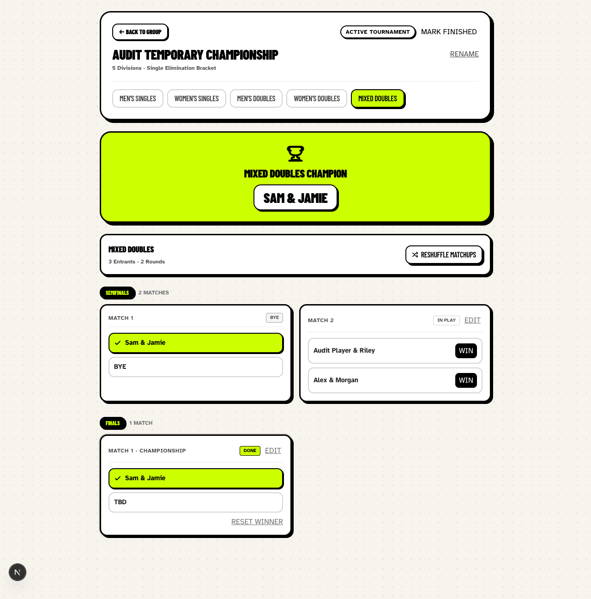
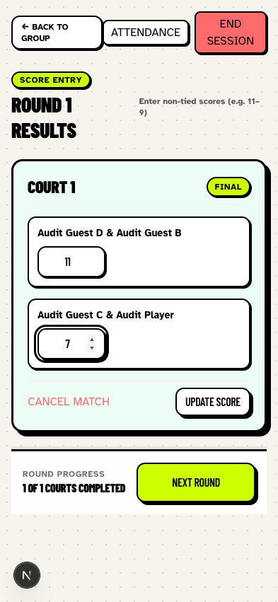
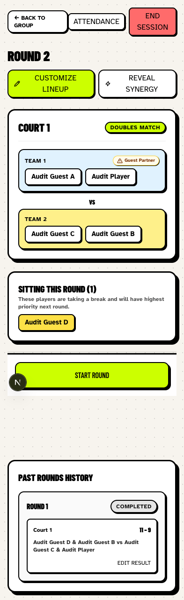
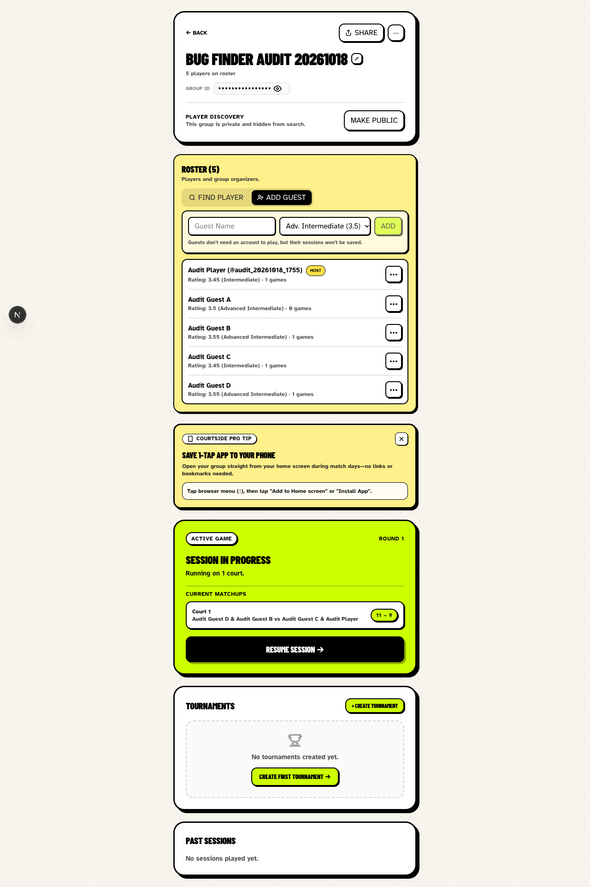
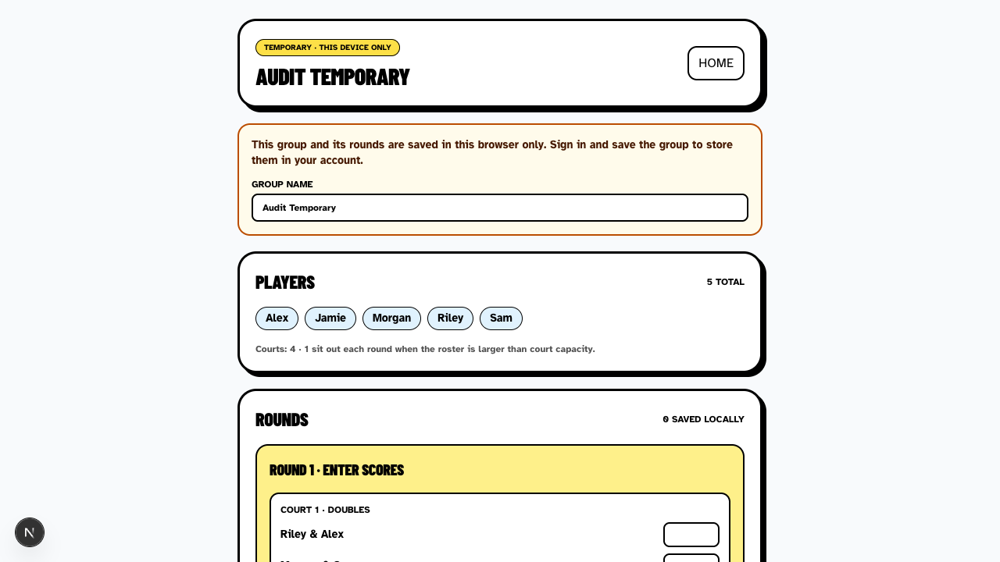

# Playwright bug audit

Date: October 18, 2026. Branch: `bug-finder`, created directly from local `development` at `d081208b316c572de8f677409c9f711ab1b1e0cc`.

> Historical audit: this report describes behavior before fixes. B01–B04 were subsequently addressed in commits `762cc27`, `dbda90b`, `32abbcf`, and `c20bdff`, respectively. The reproduction evidence below is retained for reference.

## Scope and method

Exploratory browser audit of `http://localhost:3000` using the Playwright CLI and Chromium. Desktop screenshots use 1280×720; mobile checks use a 393×851 viewport (viewport emulation, not a physical phone). Axe was injected into the browser for the guest-entry accessibility check. Application source and existing test files were left unchanged; suggestions below are proposals, not verified implementation diagnoses.

Used the existing local server and its configured database. Created account `audit_20261018_1755`, private group **Bug Finder Audit 20261018** (`grp_572c9217-a`), and imported private group **Audit Temporary** (`grp_d11df2b3-3`). Only audit-created groups were modified. These records remain available for reproduction; no existing groups were joined or edited.

## Findings

| ID | Priority | Finding |
| --- | --- | --- |
| B01 | P1 — high | Tournament can crown a champion before its opponent is known |
| B02 | P2 — medium | Next Round silently discards an unsaved score correction |
| B03 | P2 — medium | Guest skill selector has no accessible name |
| B04 | P3 — low | Temporary group shows player capacity as number of courts |

### B01 — Champion declared against TBD

**Route:** `/g/grp_d11df2b3-3/tournaments/tr_30de347d-7b9` → Mixed Doubles.

**Reproduction**

1. Create a tournament division with three doubles teams, so one team receives a semifinal bye.
2. Leave the other semifinal unplayed.
3. In the final, the bye team already appears against **TBD**, with an enabled **Win** button.
4. Click that team's **Win** button.
5. Reload and select the same division again.

**Actual:** Sam & Jamie are shown as **Mixed Doubles Champion**, the championship match is **Done** against **TBD**, and the other semifinal remains **In Play**. This state persists after reload.

**Expected:** A real match should not accept a winner until both participants and its prerequisite results are resolved. Intentional byes must remain distinguishable from an opponent still awaiting qualification.

**Impact:** An organizer can save an invalid championship result using ordinary controls, bypassing unfinished matches.

**Suggested resolution:** Disable result controls for unresolved match slots and enforce the same readiness rule on the server. Validate prerequisites when recording a winner; distinguish a structural bye from a pending participant. Revalidate or clear dependent results when upstream results change.

**Suggested regression:** A three-team division must reject a final winner before the remaining semifinal finishes; after that semifinal, the final must accept a valid winner and persist it. Cover UI and server validation, including reload.

Before: final offers **Win** against **TBD**.

After: champion and completed final coexist with the unfinished semifinal.

### B02 — Unsaved score correction is discarded by Next Round

**Route:** `/g/grp_572c9217-a/sessions/session_fc5827c5-6cc`.

**Reproduction**

1. Start a round and save Court 1 as **11–9**.
2. Change Team 2's score to **7**, leaving **Update Score** unclicked.
3. Click **Next Round**, which remains enabled.
4. Inspect Round 1 in **Past Rounds History**.

**Actual:** Round 2 is generated immediately without a save/discard prompt. Round 1 history still shows **11–9**, even though the form displayed **11–7** before proceeding. No warning explains that the correction was discarded.

**Expected:** Make pending corrections explicit and require saving or consciously discarding them before advancing. An explicit Update Score action is reasonable, but advancing should protect the pending edit.

**Impact:** An organizer can believe the corrected score was used when moving on, while the stored result and any calculations still use the old score.

**Suggested resolution:** Track dirty score fields against the persisted result. When Next Round is clicked, offer **Save and continue / Discard changes / Cancel**, or block advancement until pending edits are resolved. Apply equivalent protection when ending the session.

**Suggested regression:** Add this sequence to `tests/e2e/corrections.spec.ts`; assert the chosen save/discard behavior and persisted history after reload. Also cover dirty invalid scores.

Before: corrected score **11–7**, with Next Round enabled.

After: Round 2 appears, while Round 1 history retains **11–9**.

### B03 — Guest rating dropdown has no accessible name

**Route:** `/g/grp_572c9217-a` → **Add Guest**.

**Reproduction**

1. Open a group as its organizer.
2. Select **Add Guest**.
3. Inspect the accessibility snapshot or run Axe against the main content.

**Actual:** The rating dropdown appears as an unnamed `combobox`. Axe reports `select-name` with impact `critical`: no associated label, `aria-label`, `aria-labelledby`, or title. The screenshot shows the affected control; the missing accessible name is established by the automated evidence, not the pixels alone.

**Expected:** The dropdown has a clear visible and programmatic label such as **Guest starting skill level**.

**Impact:** Screen-reader users cannot reliably identify what the dropdown controls.

**Suggested resolution:** Add a visible label associated through `htmlFor` and a unique select ID. A precise accessible name is the minimum fix. Keep the guest name and rating controls distinguishable.

**Suggested regression:** Open the Add Guest panel before the Axe audit in `tests/e2e/resilience.spec.ts`; assert a named combobox and zero `select-name` violations.

[Axe evidence](03-axe-evidence.txt)

### B04 — Temporary group displays Courts: 4 for one court

**Route:** `/temporary`.

**Reproduction**

1. Enter five names: Alex, Jamie, Morgan, Riley, Sam.
2. Select **1** court and **4 players · 2v2**.
3. Start the temporary group and generate the first round.
4. Read the Players summary and the generated court list.

**Actual:** The summary says **Courts: 4 · 1 sit out each round**, while the round contains only **Court 1 · Doubles**.

**Expected:** Show **1 court · 4 playing · 1 sitting out**, or label the capacity clearly.

**Impact:** The organizer sees a contradictory court count even though the generated lineup uses the correct number of courts.

**Suggested resolution:** Display the number of configured courts separately from the sum of their player capacities. Avoid using the capacity value after the label Courts.

**Suggested regression:** Assert the summary for one doubles court and for multiple mixed-size courts; ensure court count, playing capacity, and sit-out count each match configuration.

## Checks that behaved correctly

- Player signup and private-group creation completed; the creator was included in the roster.
- Four guests were added and the five-player session generated one court and one sit-out.
- A tied **11–11** result was rejected with a clear error and both draft values preserved.
- A valid **11–9** result saved and allowed round progression.
- Temporary-group saved rounds synchronized across two open tabs.
- An unfinished temporary round was restored in another tab; a reload attempt showed a leave-page warning.
- Saving the temporary group to the authenticated account imported two completed rounds and navigated to the new group.

## Limits and next review

This is a targeted exploratory audit, not an exhaustive certification. No application fixes or test changes were made, and the full lint, typecheck, Vitest, simulation, and Playwright regression suites were not run. A local browser audit does not establish production behavior, cross-browser behavior, private-group access enforcement, or matchmaking fairness over many rounds.

Tournament setup also allowed five players marked **No Gender** into gender-specific divisions, including Mixed Doubles. This needs a product-rule decision before treating it as another confirmed bug: should unknown gender require assignment, or intentionally act as a wildcard? The premature-champion reproduction is independent of that decision.

Review B01 first, then B02 and B03. When implementing fixes, update the relevant E2E coverage and run the project quality gates required by AGENTS.md.
